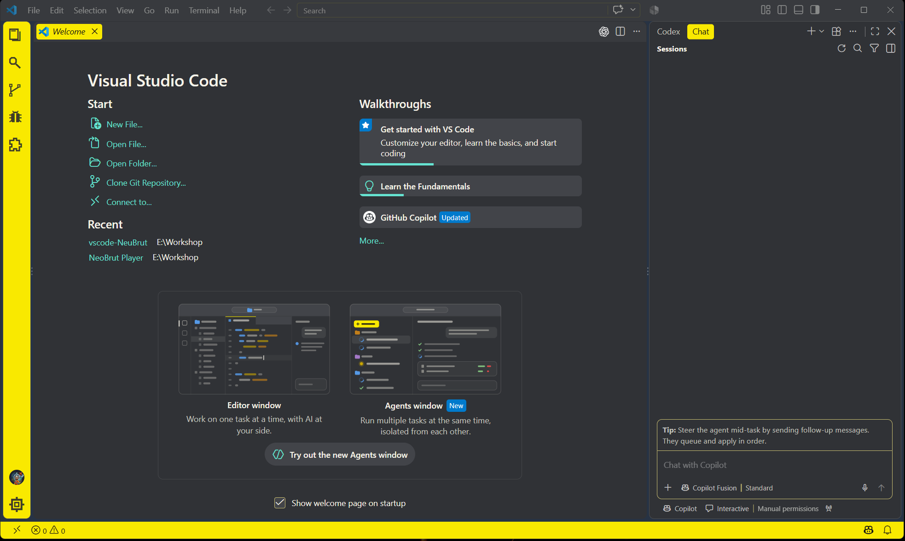
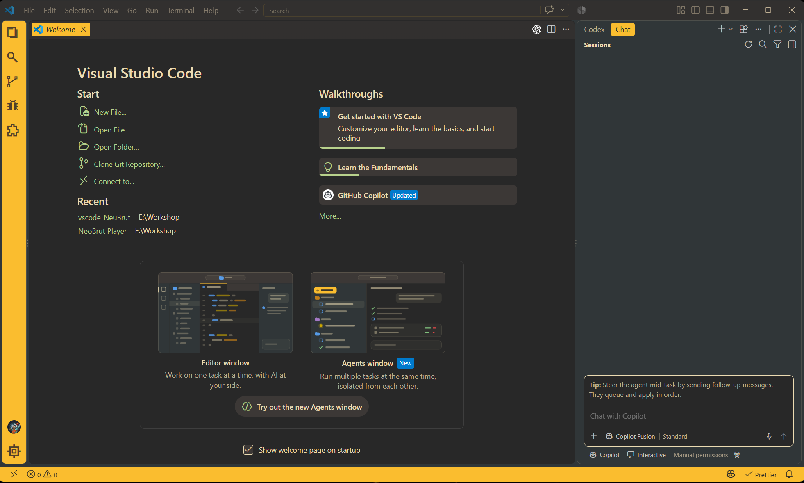
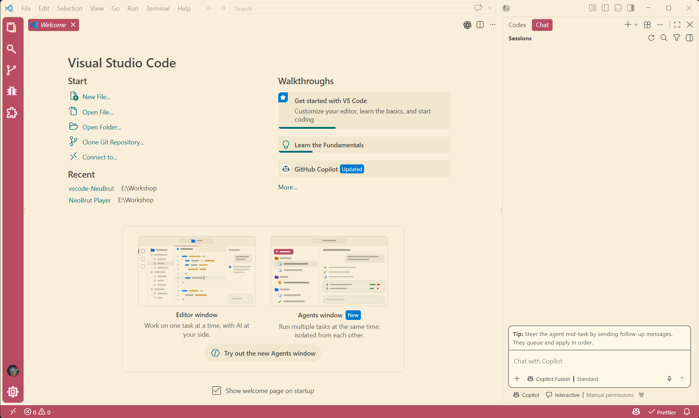
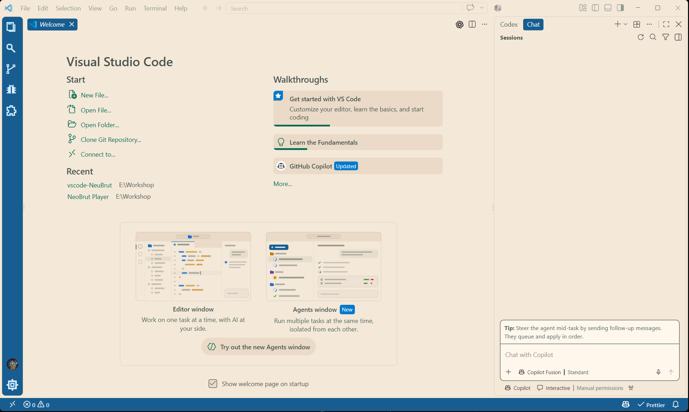
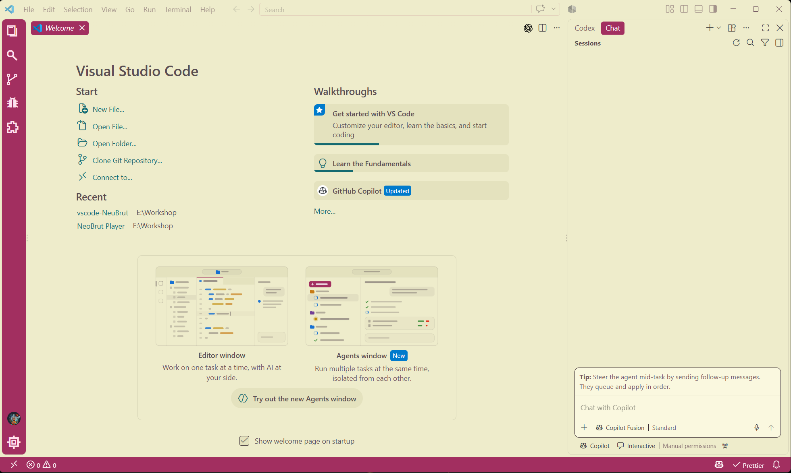
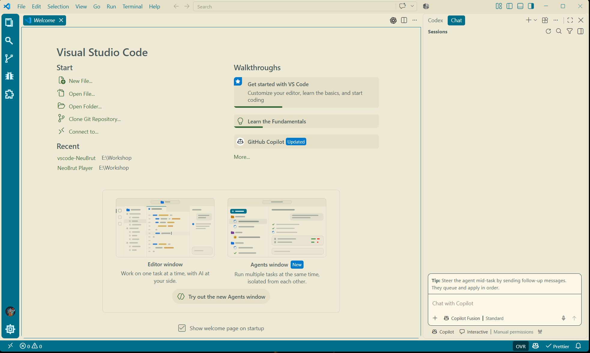

# NeuBrut

A collection of VS Code themes inspired by neo-brutalism, with bold accents and a choice of light and dark palettes. NeuBrut is designed to be easy on the eyes during everyday work, with the aim of making time at the editor more comfortable.

Everyone experiences color and screen comfort differently. NeuBrut is a personal exploration of which colors feel better and more comfortable to use. It has not been medically tested and is not a medical product or a treatment for eye strain, headaches, or migraines.

## Get started

1. Install **NeuBrut** from the VS Code Extensions view.
2. Open the Command Palette and choose **Preferences: Color Theme**.
3. Select a NeuBrut palette and try it with your usual files and lighting.
4. For matching geometric icons, choose **Preferences: Product Icon Theme** and select **NeuBrut Icons**.

## Share your experience

I'd especially welcome feedback from people who experience headaches or migraines. Does a palette feel comfortable during your usual work? Are any colors, contrasts, or highlights uncomfortable? Which palette, screen brightness, and lighting were you using?

Please [open an issue](https://github.com/vijay-krishna-ankit/vscode-neobrut-theme/issues) to share what worked or suggest improvements. Share only what you're comfortable making public; medical details aren't needed.

## Pick your palette

### Concrete

Dark gray, safety yellow, hot pink, and mint.



### Hearth

Gruvbox-inspired charcoal, warm gold, coral, and olive.



### Verdigris

Deep charcoal with muted teal, gold, and cyan.


### Midnight

Inky blue, electric blue, pink, and mint; inspired by Tokyo Night.


### Fjord

Deep slate blue, glacier blue, soft gold, and moss; inspired by Nord.


### Paper

Warm cream, muted dark grey, soft rose, and teal.



### Mint

Cool mint, deep blue, violet, and forest green.



### Lavender

Lilac paper, purple, berry, and teal; inspired by Catppuccin Latte.


### Blossom

Warm blush, raspberry, violet, and teal; inspired by Rosé Pine Dawn.



### Daybreak

Sunlit ivory, deep cyan, violet, and green; inspired by Solarized Light.



## Sidebar icons

NeuBrut Icons follows the active color theme and covers VS Code's built-in Explorer, Search, Source Control, Run and Debug, Extensions, Testing, Accounts, and Settings icons. Extension-provided icons retain their own artwork.

## Readable tab labels

VS Code can color tab labels based on Git status or problems. Those colors may be hard to read against NeuBrut's bright active tabs. To use the theme's tab text colors instead, open **Preferences: Open User Settings (JSON)** and add:

```json
"workbench.editor.decorations.colors": false
```

Git status badges can still appear on tabs, and the Explorer keeps its decoration colors.

## Pill-shaped editor tabs

VS Code themes control colors and syntax highlighting; the editor controls the shape and thickness of UI elements. In VS Code 1.141 or later, open **Preferences: Open User Settings (JSON)** and add:

```json
"workbench.experimental.modernUI": true,
"workbench.experimental.modernUIEditorTabStyle": "pill"
```

These settings are experimental and may change. The theme cannot enable the tab shape on its own.

For development and release instructions, see [CONTRIBUTING.md](CONTRIBUTING.md).

## License

Copyright © 2026 Vijay Krishna Ankit. NeuBrut is licensed under the [GNU General Public License, version 3](LICENSE).
